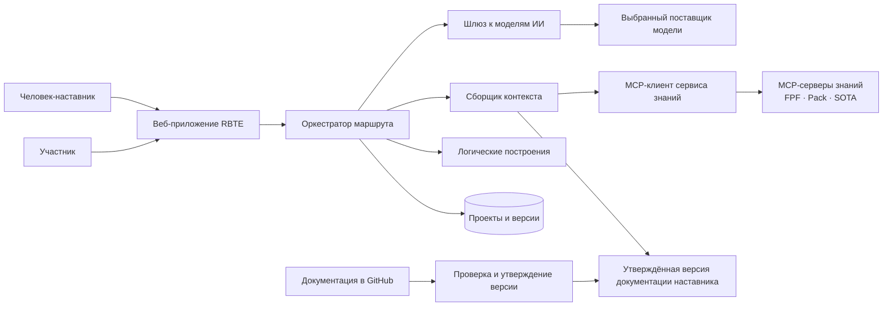

# Архитектура RBTE

**РП:** WP-45

**Статус:** рабочая версия

**Дата:** 15 ноября 2026 года

**Основание:** [Стратегия ввода RBTE](Стратегия%20ввода%20RBTE.md)
**Предыдущая редакция:** [Архитектура и модель данных первого варианта RBTE — версия 1.0](Архитектура%20и%20модель%20данных%20первого%20варианта%20RBTE%20%E2%80%94%20версия%201.0.md)

## 1. Назначение документа

Документ определяет целевую архитектуру сервиса RBTE и границы первого рабочего варианта.

RBTE — ИИ-помощник участника курса «Лидер трансформации», выпускника курса и консультанта. Он помогает человеку применять освоенные методы к собственной ситуации, сохраняет ход разработки и показывает логические построения. RBTE не заменяет освоение подхода и человека-наставника.

Первый проверяемый сквозной маршрут — решение личной дилеммы. Остальные методы подключаются после подтверждения этого маршрута.

## 2. Основные архитектурные решения

| Решение | Следствие |
|---|---|
| Серверная архитектура, управляемая RBTE | Пользователю не требуется собственный ключ доступа к модели ИИ |
| Модульное веб-приложение с общей базой данных | Первый вариант можно развивать без преждевременного разделения на микросервисы |
| Поставщик модели отделён шлюзом | Модель можно заменить без изменения маршрутов и данных проектов |
| Содержательная работа хранится в документации помощника | Приложение не дублирует правила методов в программном коде |
| Наставник использует утверждённую версию документации | Каждый ответ можно связать с конкретной редакцией ядра, модуля и источников знаний |
| В модель передаётся контекст текущего этапа, а не всё ТЗ целиком | Правила этапа не растворяются в большом системном сообщении |
| Все содержательные изменения принимает человек | ИИ предлагает, объясняет и проверяет; пользователь принимает, редактирует или отклоняет |
| Проект хранится в версиях | Работу можно безопасно продолжить, сравнить и восстановить |
| Человек-наставник видит результат и след оказанной помощи | Можно различить качество результата и то, чему научился участник |

### 2.1. Основания FPF

Архитектура проверена по публикации `FPF`, доступной через `iwe-knowledge` 15 ноября 2026 года:

- **Human Capability Development Principles Framework**, версия от 12 октября 2026 года, редакция из 29 паттернов: `HCD.9`, `HCD.28`;
- **Systems Engineering Principles Framework**, версия от 23 октября 2026 года: `SYSE.6`, `SYSE.11`, `SYSE.50`, `SYSE.52`.

MCP-сервер не сообщил отдельный номер редакции поискового индекса или коммит публикации. Даты выше являются версиями документов FPF, а не локальной Git-редакцией.

| Архитектурное решение | Паттерн | Проверяемое следствие |
|---|---|---|
| След помощи отделён от результата проекта | `HCD.9` | Хранятся первая попытка, фактически полученная помощь, действие участника после неё, повторная попытка или причина остановки; исправленный документ не выдаётся за самостоятельную способность. |
| Маршрут курса рассматривается как связное целое | `HCD.28` | Задание, материалы, помощь, обратная связь и следующая попытка доступны тогда, когда нужны; сохраняется обязательное личное действие участника. |
| Помощь выбирается по наблюдаемому состоянию шага | `SYSE.50` | Политика помощи использует доступные сигналы, различает нехватку факта, доступа, полномочия и нерешённого последствия и имеет безопасный запасной ход. |
| Контекст формируется для конкретного следующего действия | `SYSE.52` | Инструкции, наблюдения, гипотезы и прошлые результаты различимы; решающие условия и пути восстановления не теряются при сокращении контекста. |
| Выбраны определяющие границы, а не все детали реализации | `SYSE.6` | Зафиксированы альтернативы, принятые потери, открытые уточнения и условия пересмотра архитектуры. |
| Первый вариант проверяется на одном законченном применении | `SYSE.11` | Оценивается совместная работа фактической конфигурации RBTE на маршруте личной дилеммы; локальные проверки частей не заменяют сквозную проверку. |

### 2.2. Принятые потери и условия пересмотра

| Выбранное решение | Принятая потеря или открытое уточнение | Когда пересматривать |
|---|---|---|
| Модульное приложение с общей базой данных | общий цикл развёртывания и общий контур отказа | измеренная необходимость независимого масштабирования, отдельного цикла развёртывания или границы безопасности |
| Серверный доступ RBTE к модели ИИ | RBTE несёт расходы и зависимость от поставщика | подтверждённый спрос на профессиональный режим с ключом пользователя либо неприемлемые стоимость, качество или условия обработки данных |
| Утверждённая версия документации устанавливается на сервер | изменения документации появляются в рабочем наставнике только после проверки и установки | задержка обновления мешает пилоту либо механизм установки не обеспечивает воспроизводимость и безопасную миграцию проектов |
| Первым реализуется маршрут личной дилеммы | другие методы временно недоступны в приложении | маршрут полностью проходит приёмку на фактической конфигурации и выявленные дефекты не требуют изменения общей архитектуры |
| Человек принимает содержательные изменения | требуется дополнительное действие пользователя | наблюдения показывают лишние подтверждения без содержательной функции; автоматизация допускается только с сохранением ответственности и возможности исправления |

## 3. Граница системы



В границу RBTE входят:

- интерфейс работы с проектом;
- управление маршрутом и состоянием этапов;
- опубликованная документация помощника;
- получение через MCP разрешённых фрагментов FPF, Pack и SOTA;
- вызов модели ИИ через серверный шлюз;
- хранение версий проекта, логических построений и следа помощи;
- формирование отчётов.

Внешними остаются поставщик модели ИИ, GitHub как источник утверждённой документации, MCP-серверы знаний и доступные через них общие и закрытые источники.

## 4. Компоненты и ответственность

| Компонент | Отвечает за | Не отвечает за |
|---|---|---|
| Веб-интерфейс | диалог, формы, навигацию, показ логических построений и отчётов | правила методов и содержательную оценку ответа |
| Управление доступом | вход, роли, принадлежность проекта, раскрытие материалов наставнику | содержательную логику маршрута |
| Оркестратор маршрута | текущий этап, допустимые переходы, сохранение состояния, вызов нужного модуля | формулировки метода, зашитые в код |
| Сборщик контекста | сбор минимального достаточного контекста для конкретного шага | изменение источников и самостоятельное решение задачи |
| Политика помощи | выбор вида помощи по наблюдаемому состоянию шага, проверку её использования и безопасный запасной ход | восполнение отсутствующих фактов, доступа или полномочий уверенной формулировкой |
| Утверждённая версия документации наставника | постоянное ядро, модули этапов, цели, правила формулировок и приёмочные сценарии | состояние конкретного проекта |
| MCP-клиент сервиса знаний | маршрутизацию запросов к общим публикациям FPF и подключённым закрытым Pack и SOTA, выдачу разрешённых фрагментов с происхождением и редакцией | хранение самостоятельной копии источника и автоматическое принятие решения за пользователя |
| Шлюз к моделям ИИ | единый договор вызова, выбор модели, тайм-ауты, повтор, бюджет и журнал технических ошибок | правила предметной области |
| Хранилище проектов | версии ответов, карточку проекта, этапы, построения, решения и отчёты | генерацию содержательных предложений |
| Модуль логических построений | структуру узлов и связей, проверку полноты и отрисовку | подмену содержательной проверки правил метода |
| Каталог решений | кандидаты из ограничивающих предположений, SOTA и контура поведения | выбор окончательного решения |
| След помощи | запрос помощи, подсказку, действие участника после подсказки и результат проверки | скрытую оценку личности участника |
| Рабочее место наставника | раскрытые результаты, затруднения, использованную помощь и обратную связь | доступ ко всему частному диалогу без согласия участника |
| Экспорт | итоговый отчёт в браузере и Word | изменение принятого содержания проекта |

## 5. Утверждённая версия документации наставника

### 5.1. Состав версии

Каждая утверждённая версия содержит:

1. постоянное ядро: роль RBTE, общую цель, правила диалога, границы самостоятельности и общую картину маршрута;
2. манифест маршрута: этапы, порядок, входы, результаты и условия перехода;
3. модуль каждого этапа: цель работы, процедура, правила формулировок, типичные ошибки и действия при затруднении;
4. правила логических построений и их отображения;
5. приёмочные сценарии;
6. реестр используемых документов FPF, Pack и SOTA с каноническими именами источников, публикациями, редакциями и контрольными суммами, если MCP их сообщает;
7. правила формирования карточки проекта и итогового отчёта.

### 5.2. Публикация

Рабочий сервер не должен читать изменяющуюся ветку GitHub непосредственно во время диалога. **Утверждённая версия документации наставника** — это проверенный комплект документов из конкретного коммита GitHub, установленный на сервер RBTE. Перед установкой комплект проходит структурные и приёмочные проверки и получает собственный идентификатор.

Каждое обращение к модели сохраняет:

- идентификатор утверждённой версии документации;
- этап и активный модуль;
- редакции использованных источников;
- идентификатор версии проекта;
- технические сведения о вызове без раскрытия секретов.

Новая утверждённая версия применяется к новым диалогам. Продолжающийся проект сохраняет прежнюю версию документации до явной и проверяемой миграции.

### 5.3. Запрет на дублирование содержания

В программном коде допустимы только технические ограничения: схема данных, обязательность полей, допустимые переходы, права доступа и проверки целостности. Формулировки вопросов, порядок содержательной работы, правила ТОС и критерии качества находятся в документации помощника.

Если код и утверждённая версия документации расходятся, сервер прекращает содержательный переход и показывает техническую ошибку версии. Он не подменяет отсутствующее правило встроенной подсказкой.

## 6. Сбор контекста для каждого шага

Перед вызовом модели сборщик формирует пакет:

```text
постоянное ядро
+ цель текущего этапа
+ активный модуль и его приёмочные сценарии
+ актуальная карточка проекта
+ последнее принятое логическое построение
+ релевантные правила Pack
+ при необходимости — релевантные паттерны FPF
+ при необходимости — релевантные решения SOTA
+ последний ответ участника и ожидаемый результат шага
```

В пакет не включаются все документы целиком. Сборщик обязан сохранить общую картину маршрута, но выдавать модели только правила, нужные для текущего действия.

### 6.1. Обязательный доступ к знаниям через MCP

Содержательное использование FPF и любого DPF, включая Pack-TOC, PACK-ATB и PACK-AL, выполняется только через подключённый MCP-сервер знаний. Общие публикации FPF запрашиваются в общем каталоге MCP; подключённые закрытые Pack и DS обнаруживаются и читаются через контур разрешённых пользователю источников. Каноническое имя источника берётся из ответа MCP, а не из локального имени репозитория.

Перед применением паттерна или правила сборщик получает через MCP достаточный исходный текст: нужные разделы, условия применимости, ограничения и проверки. Поисковая выдержка, память модели, локальный файл, GitHub и ранее подготовленное краткое изложение не заменяют чтение источника через MCP.

Для каждого полученного фрагмента фиксируются источник, публикация, документ, идентификатор паттерна или правила, сообщённая MCP редакция и идентификатор обращения. Если редакция не сообщена, это записывается явно; локальная Git-редакция не выдаётся за редакцию серверного индекса.

Технический кэш допустим только в пределах прав доступа и срока актуальности, сообщённых MCP. Он ускоряет повторное получение, но не становится самостоятельным источником знаний. Если MCP недоступен, требуемый материал отсутствует или ответ неполон, содержательный шаг останавливается либо продолжается без применения этого источника с явным указанием ограничения; переход к локальным или GitHub-копиям автоматически не выполняется.

Для каждого элемента контекста фиксируется один способ передачи:

- точный фрагмент — когда число, правило, условие или нерешённое последствие должно сохраниться без интерпретации;
- квалифицированное краткое изложение — когда сокращение не меняет следующее решение и сохраняет неопределённость и исключения;
- восстанавливаемая ссылка — когда модель или оркестратор действительно могут получить оригинал в пределах доступного времени и прав;
- исключение — когда материал не может изменить этот шаг и определено условие, при котором контекст нужно собрать заново.

Инструкции, наблюдаемые факты, объясняющие гипотезы, предыдущие ответы модели и нерешённые последствия хранятся как разные виды данных. Сборщик проверяется не по размеру сообщения, а по тому, может ли следующий шаг восстановить решающее условие, выполнить допустимое действие и перейти к безопасному запасному ходу при потере данных.

После каждого принятого ответа обновляется карточка проекта. Она содержит как минимум цель проекта, текущий этап, принятые формулировки, открытые вопросы, активное построение, выбранные предположения и следующий ожидаемый результат. Благодаря этому контекст не переносится между модулями только через историю чата.

## 7. Доступ к моделям ИИ

### 7.1. Основной режим

RBTE хранит ключ поставщика на сервере и оплачивает вызовы в соответствии с выбранной коммерческой моделью. Ключ никогда не передаётся в браузер.

Шлюз предоставляет приложению единый договор:

- структурированный запрос и структурированный ответ;
- ограничения размера контекста;
- тайм-аут и безопасный повтор;
- оценку стоимости и лимиты;
- журнал технического результата;
- проверку поддерживаемых возможностей модели.

Для каждой модели выполняются одни и те же содержательные приёмочные сценарии. Замена поставщика считается допустимой только после их прохождения.

### 7.2. Возможный режим с ключом пользователя

Режим с собственным ключом пользователя можно добавить позже как необязательный. Ключ шифруется и хранится только на сервере. Этот режим не даёт доступа к закрытым материалам RBTE и не меняет правила публикации документации.

### 7.3. Ошибки модели

При недоступности модели приложение сохраняет введённые данные и состояние этапа. Пользователь может повторить вызов, но не обязан повторно вводить уже принятые ответы. Ошибка модели не переводит проект на следующий этап.

## 8. Модель данных

Ниже указаны логические сущности. Их физические имена могут уточняться миграциями, но границы ответственности должны сохраняться.

### 8.1. Пользователи и доступ

- `users` — пользователь;
- `roles` — участник, выпускник, консультант, наставник, администратор;
- `cohorts` и `memberships` — поток курса и участие в нём;
- `disclosures` — явное разрешение показать выбранный материал наставнику или группе.

### 8.2. Проекты и состояние

- `projects` — проект применения метода;
- `project_revisions` — неизменяемые версии проекта;
- `route_runs` — прохождение выбранного маршрута;
- `step_states` — состояние этапа, его вход, результат и проверка;
- `project_cards` — актуальная собранная карточка проекта;
- `context_assemblies` — фактически переданный на шаге контекст, способы представления элементов и результаты проверки потерь;
- `exports` — сформированные отчёты и их исходная редакция.

### 8.3. Логические построения

- `artifacts` — Туча, ДТР, отрицательная ветвь и другие построения;
- `artifact_nodes` — содержательные элементы;
- `artifact_edges` — направленные причинно-следственные или логические связи;
- `artifact_revisions` — принятые версии построения;
- `artifact_checks` — результаты проверок правил.

Текстовое описание не заменяет структуру построения. Принятая связь хранится как ребро и сразу отображается на рисунке.

### 8.4. Предположения и решения

- `assumptions` — исходные, ограничивающие и иные предположения с происхождением;
- `assumption_challenges` — постановка под сомнение и результат обсуждения;
- `solution_candidates` — предложенные варианты решений;
- `solution_sources` — связь с предположением, SOTA или другим разрешённым источником;
- `solution_applicability` — условия применимости и необходимые адаптации;
- `accepted_solutions` — выбор пользователя и его редакция.

### 8.5. Контур воспроизводства организационного поведения

- `behavior_loops` — рассматриваемый контур;
- `behavior_loop_elements` — его элементы и связи;
- `solution_effects` — каким изменением элемента решение преодолевает ограничивающее предположение.

### 8.6. Версии документации и обращения к ИИ

- `mentor_documentation_versions` — утверждённые версии документации наставника;
- `release_modules` — ядро, маршруты и модули этапов;
- `knowledge_references` — канонический источник MCP, публикация, документ, правило или паттерн, редакция, идентификатор обращения и контрольная сумма;
- `ai_interactions` — запрос, структурированный результат, модель, версия документации и технический статус;
- `assistance_policies` — наблюдаемые сигналы, допустимые виды помощи, стоимость ошибок, условия остановки и запасные ходы;
- `assistance_events` — первая попытка, фактически полученная помощь, последующее действие участника, повторная попытка или причина остановки;
- `mentor_feedback` — обратная связь человека-наставника.

Содержимое закрытых Pack и ТЗ не копируется в пользовательский проект. Хранятся разрешённый рабочий фрагмент, ссылка на источник и редакция, достаточные для воспроизводимости.

## 9. Первый сквозной маршрут: личная дилемма

Первый вариант реализует один маршрут полностью:

1. описание ситуации;
2. действия;
3. Туча;
4. проверка связей;
5. предположения;
6. проверка предположений;
7. решение;
8. план проверки на практике;
9. результат;
10. обратная связь;
11. самостоятельная практика.

Для каждого этапа определены цель, ожидаемый результат, активный модуль, правила формулировок, изображение актуального построения и условие перехода.

Сквозной маршрут считается технически и содержательно готовым, если:

- выбранные действия автоматически перенесены в элементы D и D′ Тучи;
- актуальная Туча видна и читаема при каждом вопросе о её элементах или связях;
- принятые связи немедленно отображаются стрелками;
- помощник распознаёт неправильно сформулированные элементы и помогает участнику переформулировать их;
- участник может принять, изменить или отклонить предложение ИИ;
- продолжение проекта восстанавливает карточку, построение, этап и версию документации;
- помощь фиксируется вместе с тем, как участник ею воспользовался;
- человек-наставник получает раскрытый участником результат и след помощи;
- итоговый отчёт воспроизводит путь разработки без служебного диалога.

Готовность устанавливается для названной фактической конфигурации приложения, утверждённой версии документации, модели и условий работы. Успех отдельных экранов, модулей или ответов модели не заменяет прохождение всего маршрута. Вывод не распространяется на другой метод, модель или существенно изменённые условия без новой проверки.

## 10. Подготовка решений для плана трансформации

После подтверждения первого маршрута архитектура поддерживает модуль плана трансформации. На этапе подготовки решения RBTE формирует кандидатов из трёх источников:

1. решений, выведенных из найденных ограничивающих предположений;
2. готовых решений SOTA с известными условиями применимости;
3. решений, изменяющих элементы контура воспроизводства организационного поведения.

Для каждого кандидата показываются происхождение, преодолеваемое предположение, условия применимости, механизм действия и требуемая адаптация. Готовое решение не принимается автоматически. Окончательный выбор и формулировка остаются за пользователем.

## 11. Режимы работы и роль человека

### 11.1. Работа на курсе

RBTE помогает выполнить работу и одновременно собирает свидетельства освоения: где участнику потребовалась помощь, какую помощь он получил и как использовал её после подсказки. Человек-наставник обсуждает трудные места, корректирует понимание и принимает итог работы.

### 11.2. Работа выпускника или консультанта

Пользователь может применять тот же метод к рабочей ситуации без обязательного сопровождения. Подсказки и проверки сохраняются, а учебные пояснения могут быть сокращены. При необходимости пользователь раскрывает выбранный результат наставнику или коллеге.

### 11.3. Граница приватности

По умолчанию наставник не видит весь частный диалог. Ему доступны только явно раскрытые материалы, итоговые построения, отмеченные затруднения и след оказанной помощи в объёме, необходимом для обратной связи.

## 12. Защита материалов и данных

- Pack-TOC, PACK-ATB, DS-RBTE и PACK-AL остаются в закрытых источниках знаний и доступны серверу RBTE только через авторизованный MCP-контур; ТЗ помощника устанавливается как утверждённая серверная версия.
- Доступ к общим публикациям FPF через MCP сохраняется во всех рабочих окружениях RBTE и проверяется перед развёртыванием.
- Пользователь получает результат работы и разрешённые объяснения, но не исходные закрытые документы.
- В модель передаётся минимальный необходимый фрагмент; секреты и лишние персональные данные маскируются.
- Доступ к проектам ограничивается владельцем, явно разрешёнными участниками и назначенным наставником.
- Все изменения проекта имеют автора, время и исходную редакцию.
- Секреты хранятся отдельно от кода и базы прикладных данных.
- Журнал технических событий не должен становиться скрытой копией полного диалога.
- Для базы данных и утверждённых версий документации выполняются резервное копирование и проверка восстановления.
- Условия поставщика модели по хранению данных фиксируются для каждого рабочего окружения.

## 13. Развёртывание

Первый вариант развёртывается как модульное серверное приложение:

- веб-приложение и серверные маршруты;
- фоновая обработка длительных вызовов и экспорта;
- PostgreSQL для проектов и версий;
- объектное хранилище для изображений и отчётов;
- сервис утверждённых версий документации;
- серверный MCP-клиент с раздельными маршрутами к общим публикациям FPF и разрешённым закрытым Pack и SOTA;
- шлюз к поставщику модели;
- мониторинг, журнал ошибок и резервное копирование.

Используются отдельные окружения разработки, приёмки и пилота. Версия приложения и утверждённая версия документации наставника меняются независимо, но их совместимость проверяется перед развёртыванием.

Переход к микросервисам допускается только при появлении измеренной нагрузки, независимого цикла развёртывания или отдельной границы безопасности. До этого модульный монолит остаётся предпочтительным.

## 14. Порядок ввода

1. Личная дилемма в сопровождении автора: подтверждение правильности маршрута и помощи.
2. Личная дилемма на курсе: проверка самостоятельной работы и рабочего места наставника.
3. Использование выпускниками: проверка повторного применения без постоянного сопровождения.
4. Подключение следующих методов: конфликт сторон, Туча тушения пожара, предложение ценности и план трансформации.
5. Ограниченный внешний вход: проверка, приводит ли RBTE подходящих людей к обучению.

Расширение на следующий метод начинается только после того, как предыдущий маршрут проходит приёмочные сценарии в приложении и не требует обхода через ручную работу в Codex.

## 15. Отказы и безопасное восстановление

| Отказ | Поведение системы |
|---|---|
| Утверждённая версия документации отсутствует или не прошла проверку | содержательный диалог не начинается; показывается идентификатор ошибки версии |
| MCP либо требуемый источник FPF, Pack или SOTA недоступен, неполон или имеет неподтверждённую редакцию | содержательный шаг не применяет этот источник; обязательный для шага источник блокирует переход до восстановления подтверждённого доступа |
| Модель не ответила | ввод и состояние сохраняются; доступен безопасный повтор |
| Ответ модели не соответствует схеме | результат не принимается и не меняет проект |
| Изображение построения не сформировано | работа с построением не продолжается; пользователь видит понятное сообщение |
| Карточка проекта и этап расходятся | переход блокируется до восстановления последней согласованной версии |
| Новая версия документации несовместима с проектом | проект продолжает работу с прежней версией либо проходит явную миграцию |
| Лимит расходов достигнут | новые вызовы приостанавливаются без потери проекта |

## 16. Что сохранено и что отложено по сравнению с версией 1.0

Сохранены технически полезные решения версии 1.0:

- модульное приложение с PostgreSQL;
- серверная авторизация и разграничение доступа;
- неизменяемые версии результатов;
- заменяемый адаптер модели ИИ;
- закрытый сервис знаний с происхождением источников;
- явное принятие, изменение или отклонение предложений ИИ;
- маскирование данных, бюджеты, аудит и резервное копирование.

Отложены до появления подтверждённой необходимости:

- универсальная среда для любых предметных областей;
- одновременная реализация всех профилей RBTE;
- отдельные контуры CGOV и KCAE;
- исследовательские прогоны как часть первого продукта;
- векторная база как обязательный компонент;
- микросервисное разделение;
- сложная модель инженерных изменений, не нужная маршруту личной дилеммы.

Версия 1.0 сохранена отдельно как историческое основание и не используется как действующее архитектурное решение.
